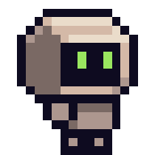

<p align="center">
  
</p>

# Gravitate

[](https://github.com/remarkablegames/gravitate/releases)
[](https://github.com/remarkablegames/gravitate/actions/workflows/build.yml)

🧲 Guide a robot through platformer puzzles by shifting gravity in four directions. Roll across walls, walk on ceilings, and use the room itself to find your way out.

Play in your browser:

- [remarkablegames](https://remarkablegames.org/gravitate/)

Or download for desktop:

- [Windows](https://github.com/remarkablegames/gravitate/releases/latest/download/windows.zip)
- [macOS](https://github.com/remarkablegames/gravitate/releases/latest/download/macos.zip)
- [Linux](https://github.com/remarkablegames/gravitate/releases/latest/download/linux.zip)

## How to Play

- WASD or arrow keys to move/jump (keyboard required)
- Touch a green arrow to shift gravity to its direction
- Reach the blue portal to advance to the next level
- Spikes or falling out of bounds restart the current level

## Features

- 15 handcrafted levels with a gradual difficulty curve
- 4-direction gravity: floors, walls, and ceilings
- Momentum-based jumps and mid-air gravity shifts
- Spikes, gaps, and platforming hazards
- 3 sci-fi music tracks and sound effects
- Pixel-art visuals and responsive scaling

## Credits

- [Sci-fi Platformer - 16x16 Asset Pack](https://wrabitart.itch.io/sci-fi-platformer-asset-pack)
- [Sci-Fi Game Music Pack](https://alkakrab.itch.io/free-sci-fi-game-music-pack)
- [Pixelart Arrow Icons Pack](https://ibingames.itch.io/pixelart-arrow-icons-pack)
- [Game Sounds](https://github.com/remarkablegames/game-sounds)

## Prerequisites

[nvm](https://github.com/nvm-sh/nvm#installing-and-updating):

```sh
brew install nvm
```

## Install

Clone the repository:

```sh
git clone https://github.com/remarkablegames/gravitate.git
cd gravitate
```

Install the dependencies:

```sh
npm install
```

## Environment Variables

Update the environment variables:

```sh
cp .env .env.local
```

Update the **Secrets** in the repository **Settings**.

## Available Scripts

In the project directory, you can run:

### `npm start`

Runs the game in the development mode.

Open [http://localhost:5173](http://localhost:5173) to view it in the browser.

The page will reload if you make edits.

You will also see any errors in the console.

### `npm run build`

Builds the game for production to the `dist` folder.

It correctly bundles in production mode and optimizes the build for the best performance.

The build is minified and the filenames include the hashes.

Your game is ready to be deployed!

### `npm run bundle`

Builds the game and compresses the contents into a ZIP archive in the `dist` folder.

Your game can be uploaded to your server, [itch.io](https://itch.io/), etc.

## Testing

Start a level by appending `?level=<number>` to the URL:

```
http://localhost:5173/?level=0
```

View cover image by appending `?cover` to the URL:

```
http://localhost:5173/?cover
```
